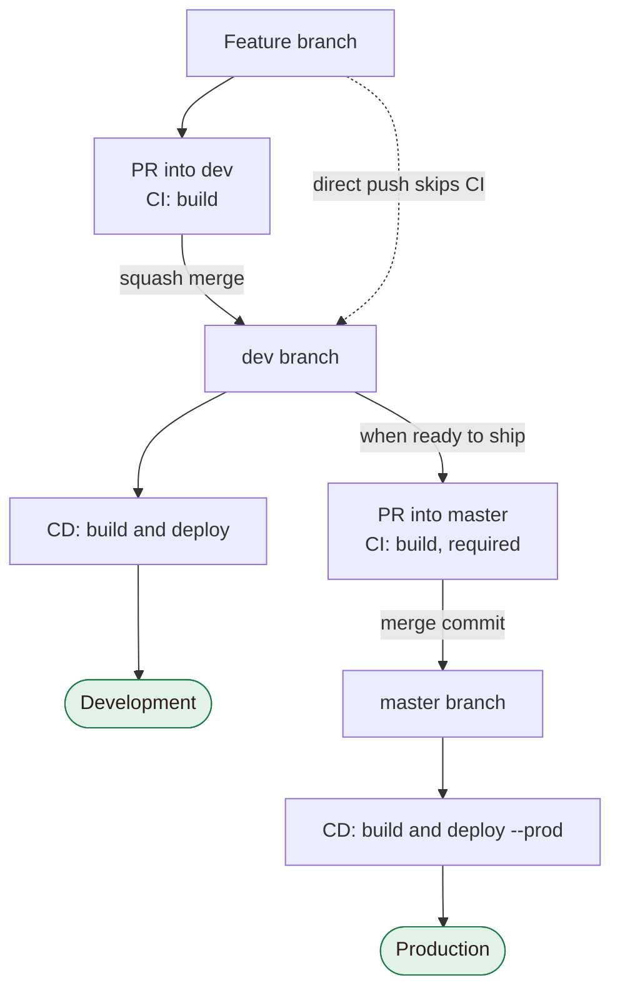
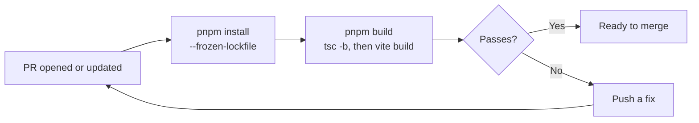
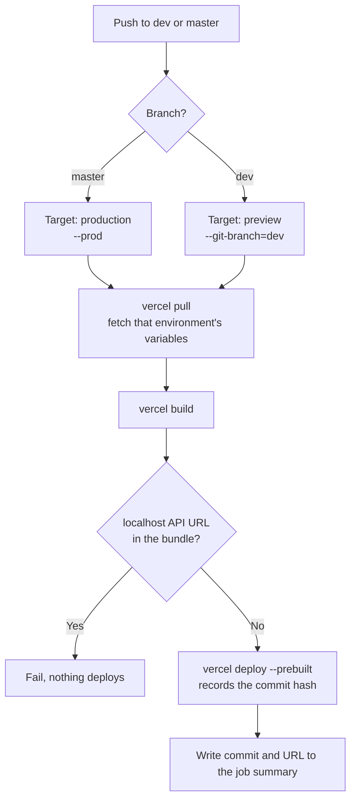

# CI/CD Workflow

How code gets from a branch to Development and Production, using GitHub Actions and the Vercel CLI.

> **Status (2026-11-03): not live yet.** The workflows haven't run on GitHub or deployed to Vercel.
> Finish [First-time setup](#first-time-setup) first, then delete this note.

## In short

- **CI** runs on pull requests. It builds the code and never deploys.
- **CD** runs on pushes to `dev` and `master`. It builds and deploys that commit.
- A merged PR deploys automatically, so **merging to `master` ships to production**.

| Environment | Branch   | Vercel target                        | Workflow trigger |
| ----------- | -------- | ------------------------------------ | ---------------- |
| Development | `dev`    | Preview, with `dev` branch variables | Push to `dev`    |
| Production  | `master` | Production                           | Push to `master` |

## Workflow

## CI: `.github/workflows/ci.yml`

CI answers one question: does this pull request build?

- A new push to the PR cancels the run in progress.
- CI uses no secrets, so it is safe for pull requests from forks.
- The job is named `build`, and the `master` ruleset requires that name. Renaming it blocks merging.
- `pnpm test`, ESLint and bundle size aren't checked yet. See [Known limits](#known-limits).

## CD: `.github/workflows/cd.yml`

CD deploys the commit that was pushed. It starts on the push and doesn't check CI's result.

- Runs on the same branch queue rather than cancel, so an older run can't overwrite a newer deploy.
- `VITE_*` values are baked in at build time, so each environment gets its own build. CD can't reuse CI's build.
- The localhost check exists because `src/api/endpoints.ts` falls back to `localhost` when a URL variable is unset, and the build still succeeds.

## Everyday tasks

### Ship a change to Development

1. Branch from `dev` and open a PR into `dev`.
2. Wait for the `build` check.
3. Squash-merge. CD deploys to Development.

Direct commits to `dev` also deploy, but they skip CI.

### Ship to Production

1. Check the change on Development.
2. Open a PR from `dev` into `master`.
3. Wait for the `build` check.
4. Merge with a **merge commit**. CD deploys to Production.

Don't squash this PR. Squashing makes the two branches' histories diverge and causes repeat conflicts.

### Find which commit is deployed

The deployed hash is the merge commit's hash, not the last commit on your PR.

- **GitHub:** the repo's Deployments page lists each environment's commit and URL.
- **Vercel CLI:** `vercel list --meta githubCommitSha=<sha>` finds the deployment for a commit.

### Roll back Production

1. Use [Instant Rollback](https://vercel.com/docs/instant-rollback) in the Vercel dashboard. On the Hobby plan, it only reaches the immediately previous deployment.
2. Ship the fix or a revert through a normal PR. To go back further, revert on `master`.
3. **Run `vercel promote` or use Undo Rollback.** After a rollback, Vercel stops assigning production domains automatically, so new deploys won't go live until you do.

### Add or change an environment variable

1. Add it in Vercel for Production, and for Preview on branch `dev`.
2. Add the name to `.env.example`.
3. Deploy again. Existing deployments keep the old value because it is baked in at build time.

## Troubleshooting

| What you see                                       | Likely cause                                             | Fix                                                                     |
| -------------------------------------------------- | -------------------------------------------------------- | ----------------------------------------------------------------------- |
| `Cannot update packageManagerDependencies`         | `pnpm-lock.yaml` is out of step with `packageManager`    | Run `pnpm install` and commit the lockfile with `package.json`          |
| `Bundle contains a localhost API URL`              | A `VITE_*` URL is unset for that environment in Vercel   | Add the variable in Vercel and re-run the workflow                      |
| CD succeeds, but Production doesn't change         | The project is still rolled back                         | Run `vercel promote` or use Undo Rollback                               |
| Two deployments for one push                       | Vercel's Git deploys are on                              | Check that `git.deploymentEnabled` is `false` in `vercel.json`          |
| A direct link such as `/place/1` returns a 404     | The SPA rewrite is missing                               | Check `rewrites` in `vercel.json`                                       |
| `build` isn't offered when creating the ruleset    | CI hasn't run yet                                        | Open a PR once, then add the required check                             |
| The PR can't merge, and `build` never starts       | The job was renamed, or the PR doesn't target a CI branch | Keep the job name `build`, and target `dev` or `master`                 |

## First-time setup

A new Vercel project's first deployment is always a production one, so do these in order.

### Vercel

- [ ] Run `npm i -g vercel@65.10.0`, then `vercel login` and `vercel link` in the repo.
- [ ] Run `vercel pull --environment=preview` and `vercel build`, and confirm `.vercel/output/static/index.html` exists.
- [ ] Create a token with an expiry, and note the renewal date.
- [ ] Add `VITE_AUTH_API_URL`, `VITE_RECOMMENDATIONS_API_URL` and `VITE_RECOMMENDATION_APP_ID` for Production, and again for Preview on branch `dev`.
- [ ] Confirm the framework preset is Vite.

### GitHub

- [ ] Add the secrets `VERCEL_TOKEN`, `VERCEL_ORG_ID` and `VERCEL_PROJECT_ID`. The two IDs are in `.vercel/project.json`.
- [ ] Create the environments `production`, limited to `master`, and `development`, limited to `dev`.
- [ ] Allow both squash merges and merge commits under Settings > General.

### Rollout

- [ ] Open a PR into `master` with these files, and confirm CI runs without deploying.
- [ ] Merge it, which triggers the first production deploy.
- [ ] Create `dev` from `master` and push it, which triggers the first development deploy.
- [ ] In Vercel, assign a stable domain to `dev`: Settings > Domains, choose Preview, Git Branch `dev`.
- [ ] Add a `master` ruleset: require a PR and the `build` check, and block force pushes. Set no required approvals, since GitHub doesn't let you approve your own PR.

## Known limits

- **No gate before Production.** Any push to `master` ships immediately, with no staging step or pre-live check.
- **`dev` has no ruleset.** A failed PR can still merge, and direct pushes deploy without CI.
- **Checks not in CI.** `pnpm test` exits 1 because there are no test files, ESLint isn't installed, and the main chunk is 207 KB gzipped against a 170 KB budget.
- **No version numbers.** Deployments are tracked by commit hash only.
- **No manual deploys.** CD only deploys what was just pushed, so you can't choose a commit to deploy.
- **`*.vercel.app` domains.** Sign-in can't be fully tested on Safari or iOS. Move to a custom domain before Saved, Account or Add-a-place reach production.
- **Vercel Hobby plan.** It is non-commercial only. Ads, affiliate links or paid partnerships mean moving to Pro.
- **`VERCEL_TOKEN` is long-lived.** Rotate it before it expires, and never use `pull_request_target`, because this repo is public.
